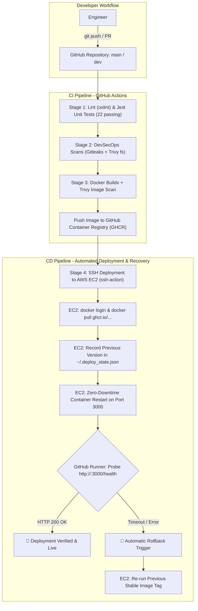

# DevOps Ticket Manager API
### DevOps Engineer Intern – Technical Assignment
**Selected Assignment Set:** **Set C: CI/CD Pipeline**  
*(With Integrated Production Containerization & Live AWS Cloud Deployment)*

---

## 📌 Executive Summary

This project implements a CI/CD pipeline and microservice architecture for a **Ticket Manager API**. Built with **NestJS (TypeScript)** and managed with **pnpm**, the service is packaged into a hardened multi-stage Docker container and continuously deployed to an **AWS EC2** instance via **GitHub Actions**.

* **Live API & Swagger Documentation:** `http://3.109.157.50:3000/api/docs`
* **Health Endpoint:** `http://3.109.157.50:3000/health`
* **Version / Commit SHA Metadata:** `http://3.109.157.50:3000/version`
* **Package Registry:** GitHub Container Registry (GHCR) (`ghcr.io/ritikkumar27/devops-ticket-api`)
* **Compute Target:** AWS EC2 (Ubuntu 26 LTS running Docker)

---

## 📁 Repository Structure

```
devops-ticket-api/
├── .github/
│   └── workflows/
│       ├── ci.yml                 # Primary CI/CD: Lint, Test, Scan, Build, Deploy, Verify, Rollback
│       └── rollback.yml           # On-demand operator rollback workflow (workflow_dispatch)
├── backend/                       # NestJS TypeScript Microservice
│   ├── src/
│   │   ├── health/                # System vital signs: /health, /health/liveness, /health/readiness
│   │   ├── version/               # Deployment metadata: /version (version, commit SHA, timestamp)
│   │   ├── tickets/               # Core domain: Controller, Service, Entity, DTOs
│   │   │   ├── dto/               # class-validator DTOs (create & update)
│   │   │   ├── entities/          # Ticket entity & priority/status enums
│   │   │   ├── tickets.service.ts # In-memory store with initial seeded tickets & metrics
│   │   │   └── tickets.controller.ts # REST API routes with OpenAPI Swagger annotations
│   │   ├── app.module.ts          # Root module wiring
│   │   └── main.ts                # Bootstrap, CORS, validation pipe, Swagger setup
│   ├── Dockerfile                 # Hardened 3-stage Alpine Dockerfile (pnpm, non-root UID 10001)
│   ├── .dockerignore              # Clean build context exclusion
│   ├── package.json               # Dependencies & npm scripts
│   ├── pnpm-lock.yaml             # Frozen dependency lockfile
│   ├── pnpm-workspace.yaml        # pnpm workspace configuration
│   ├── tsconfig.json              # TypeScript NodeNext ESM compiler options
│   └── jest.config.ts             # Jest ESM test runner configuration
├── scripts/
│   ├── deploy.sh                  # Local/runner deployment script with version tracking
│   ├── verify.sh                  # Health polling verification script with exponential backoff
│   └── rollback.sh                # Instant rollback script to previous stable version
├── docker-compose.yml             # Local multi-container development orchestration
└── README.md                      # Project documentation
```

---

## ⚙️ Technical Assignment Breakdown (Set C)

### Question 1: Build a CI/CD Pipeline
* **Trigger Conditions:** Automatically triggers on every `push` and `pull_request` to `main` and `develop`, with manual trigger support via `workflow_dispatch`.
* **Deterministic Dependencies:** Uses `pnpm/action-setup@v3` with `pnpm install --frozen-lockfile` and actions caching (`cache: 'pnpm'`) for reproducible, rapid installation.
* **Code Validation & Testing:** Runs strict TypeScript type-checking and linting via `oxlint --type-aware` followed by 5 Jest test suites (22 unit tests) with complete coverage across controllers and services.
* **Container Packaging:** Builds a multi-stage Docker image using `docker/setup-buildx-action` and pushes dual-tagged images (`latest` and immutable `sha-<commit>`) to GitHub Container Registry (`ghcr.io`).
* **Reporting:** Emits clear, auditable step-by-step logs and halts immediately with exit code `1` if any lint, test, or build step fails.

### Question 2: Automated Deployment & Failure Recovery
* **Deployment Trigger:** Triggers automatically upon successful merge to the `main` branch.
* **Configuration Delivery:** Credentials and environment configurations are injected securely through GitHub Repository Secrets (`EC2_HOST`, `EC2_USER`, `EC2_SSH_KEY`).
* **Cloud Execution:** Connects via SSH (`appleboy/ssh-action`) to the **AWS EC2** instance, logs into GHCR, pulls the new image, updates local deployment state (`~/.deploy_state.json`), and starts the container on port `3000`.
* **Automated Failure Detection:** The GitHub Actions runner polls `http://3.109.157.50:3000/health` up to 15 times with a 2-second sleep. It validates HTTP 200 OK and confirms the active commit SHA via `/version`.
* **Automated Rollback:** If the health check fails after 15 attempts, the pipeline traps the failure (`if: failure() && steps.deploy_step.outcome == 'success'`) and automatically SSHs into EC2 to restart the previous recorded container image.
* **On-Demand Rollback:** A dedicated workflow (`.github/workflows/rollback.yml`) allows engineers to trigger an instant rollback to any specific tag or previous SHA from the GitHub UI.

### Question 3: Secrets and Pipeline Security
* **Zero Hardcoded Secrets:** Private keys, database passwords, and host credentials are never stored in source code or committed to Git.
* **Secret Leak Prevention:** Integrated **Gitleaks** (`gitleaks/gitleaks-action@v2`) in CI to scan commit history and prevent accidental credential leaks.
* **Dependency & Container Vulnerability Scanning:** Integrated **Aqua Security Trivy** (`aquasecurity/trivy-action`) to scan:
  1. Project dependencies (`scan-type: 'fs'`) for high and critical CVEs.
  2. The packaged Docker container image (`scan-type: 'image'`) for OS and package vulnerabilities before deployment.
* **Least-Privilege Scoping:** Permissions are restricted explicitly in the workflow:
  ```yaml
  permissions:
    contents: read
    packages: write
    security-events: write
  ```
* **Container Runtime Security:** The application runs under an unprivileged user (`appuser`, UID `10001`), completely eliminating root container breakout vulnerabilities. Uses `dumb-init` for POSIX signal propagation (`SIGTERM`).

---

## 🚀 Local Quickstart & Testing

### 1. Prerequisites
* **Node.js**: v20 or v22 LTS
* **pnpm**: v9 or v10 (`corepack enable pnpm`)
* **Docker** (optional, for container runs)

### 2. Local Setup
```bash
# Navigate to backend directory
cd backend

# Install dependencies deterministically
pnpm install --frozen-lockfile

# Run linter
pnpm run lint

# Run unit tests
pnpm test

# Start in development watch mode
pnpm run start:dev
```

The application will be live at:
* **Interactive Swagger UI:** [http://localhost:3000/api/docs](http://localhost:3000/api/docs)
* **Health Check:** [http://localhost:3000/health](http://localhost:3000/health)
* **Version Endpoint:** [http://localhost:3000/version](http://localhost:3000/version)

### 3. Local Container Run
```bash
# Build the Docker image locally
docker build -t devops-ticket-api:local ./backend

# Run the container
docker run -d --name ticket-api -p 3000:3000 devops-ticket-api:local

# Test health endpoint
curl -i http://localhost:3000/health
```

---

## 📡 API Endpoints Reference

| Method | Endpoint | Description |
| :--- | :--- | :--- |
| `GET` | `/health` | System uptime, process memory (heap/RSS), Node.js version, and overall status |
| `GET` | `/health/liveness` | Container liveness probe |
| `GET` | `/health/readiness` | Load balancer readiness probe |
| `GET` | `/version` | Deployed release version, Git commit SHA, and environment |
| `GET` | `/api/docs` | Interactive OpenAPI Swagger UI documentation |
| `GET` | `/tickets` | List all operational tickets (supports `?status=OPEN&priority=HIGH`) |
| `GET` | `/tickets/metrics` | Returns total ticket counts grouped by status |
| `POST` | `/tickets` | Create a new operational ticket (validated via DTO) |
| `GET` | `/tickets/:id` | Get details of a single ticket |
| `PATCH` | `/tickets/:id` | Update status, assignee, or description |
| `DELETE` | `/tickets/:id` | Delete a ticket |

---

## 🤖 AI Assistance Disclosure
In accordance with Section 3, Item 7 of the assignment requirements:
* **AI Tool Utilized:** Antigravity Coding Assistant
* **Usage:** Assisted in designing CI/CD workflow configurations (GitHub Actions YAML syntax), troubleshooting Node.js ESM specifier resolution, and formatting architectural documentation.
* **Verification:** All generated configurations, code changes, and test suites were reviewed, executed, debugged, and verified manually in both local development environments and on live AWS EC2 cloud infrastructure.


## 🏛️ End-to-End System Architecture



---
